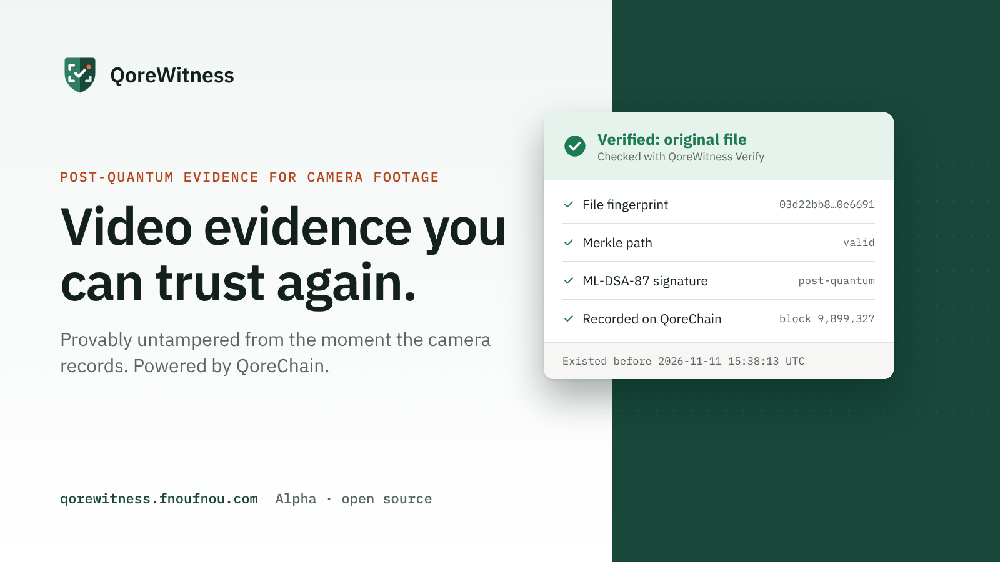

# QoreWitness

Post-quantum proof that your home camera footage is original, and of when it was recorded.

[](https://github.com/fnoufnou/qorewitness/actions/workflows/test.yml)
[](https://github.com/fnoufnou/qorewitness/tags)
[](https://github.com/fnoufnou/qorewitness/pkgs/container/qorewitness)
[](LICENSE)
[](https://build.qorechain.io/p/qorewitness)




- **What it is.** A recorder next to your camera fingerprints every clip. Every 10 minutes the camera's own ML-DSA-87 key signs the fingerprints. The AnchorRegistry contract on QoreChain checks that signature on chain with the `pqcVerify` precompile and stores it. You get a receipt per clip that anyone can check later.
- **It works live.** A real home camera seals its video every 10 minutes since 9 Nov 2026, on registry v4 since 14 Nov 2026.
- **Status.** Beta on the QoreChain test network (qorechain-diana, EVM chain ID 9800), built for the QoreChain Developer Fest. Test tokens only. The test network can be reset, so do not use QoreWitness as your only evidence yet.

## Check it in 2 minutes

1. Download the [sample clip](https://qorewitness.fnoufnou.com/sample-clip.mp4) and its [receipt](https://qorewitness.fnoufnou.com/sample-receipt.json). The live camera sealed them on 24 Nov 2026.
2. Open [QoreWitness Verify](https://qorewitness.fnoufnou.com/verifier.html) and drop both files on it. Result: green "Original".
3. Press "Try it: change one byte and check again". Result: red.
4. See the [sample seal on chain](https://explore.qore.network/tx/0xc144eb064bc87a199711ba178493f13bfdee2f48664aa3946404c8ca594fa482) (block 10,653,907).
5. See [every seal of the live camera](https://explore.qore.network/address/0xa1378D6558B32e1f8d37b68cf90e3C93839Da365) on registry v4, for example [this one from 27 Nov 2026, 20:50 UTC](https://explore.qore.network/tx/0xaf4a05d351beaed050762927969c33c1cf6f7ac7d0ee28220bf3d1e23f99aaf0).

Without a browser: `python3 tools/verify_receipt.py sample-receipt.json sample-clip.mp4` (standard library only).

| More | Link |
|---|---|
| Website | https://qorewitness.fnoufnou.com |
| For the jury | https://qorewitness.fnoufnou.com/jury.html |
| Video (2:43) | https://youtu.be/RSHszgfsqm8 |
| Project page | https://build.qorechain.io/p/qorewitness |
| Install on your own camera | [docs/INSTALL.md](docs/INSTALL.md) |
| Run the tests | `pnpm install --frozen-lockfile --ignore-scripts && pnpm test` (279 tests) |

## Why post-quantum

Evidence can be needed 10 to 30 years after recording. Classical signatures (ECDSA, RSA) may be broken by then. ML-DSA-87 (FIPS 204) signatures keep the link between device, owner and time valid in that period. The hash commitment itself is already fairly robust against quantum computers. The post-quantum value is mainly in the signatures.

## Why not C2PA, Truepic or OpenTimestamps

- C2PA and Truepic sign at capture, but only on cameras and apps built for it. QoreWitness works with the cameras people already own.
- OpenTimestamps proves that a file existed, one file at a time. QoreWitness also chains every clip to the one before, so a missing or swapped clip shows.
- The camera signs with a post-quantum key, and the chain itself checks that signature.

## How it works

```
camera (RTSP) -> ffmpeg: 60-second segments -> agent: SHA-256 + SHA3-256 per segment
  -> 10-minute window -> Merkle root -> ML-DSA-87 signature by the camera key
  -> AnchorRegistry.anchor() on QoreChain (pqcVerify on chain)
  -> receipt JSON next to the recordings
verifier (static web page or CLI): file + receipt -> hash, Merkle path,
  verifyAnchor on chain, device key, ML-DSA-87 signature
```

The block time is the trusted "existed before" time. Since registry v4, every segment and every window is chained to the one before it. The camera also signs a recent block hash, so the time is bounded on both sides.

Two keys, two layers of post-quantum protection:

| Key | Holder | Signs | Checked by |
|---|---|---|---|
| Owner key: the account's ML-DSA-87 key registered on chain | Owner account | Native-lane txs (hybrid), EVM window, register and revoke a device | Chain, and the contract via `pqcKeyStatus` (`0x...0A02`) + `pqcVerify` (`0x...0A01`) |
| Device key: one ML-DSA-87 key per camera | Agent next to the camera | Window roots, key rotation (old and new key) | Contract via `pqcVerify` |

1. Chain level. Every EVM transaction needs a registered ML-DSA-87 key and an EVM authorisation window. The agent opens a window that is scoped to the registry only (`allowed_targets`).
2. Application level. Every state change in the registry needs fresh ML-DSA-87 signatures. A stolen ECDSA key, even inside an open window, cannot anchor, register, revoke or rotate.

## Live on testnet (qorechain-diana, EVM chain ID 9800)

QoreWitness targets the qorechain-diana testnet, where the fest is judged. The QoreChain PQC precompiles (`pqcVerify`, `pqcKeyStatus`) are not active on mainnet yet, so QoreWitness does not run on mainnet.

| What | Address |
|---|---|
| Registry v4 (14 Nov, chained windows, time bound on both sides, live) | [0xa1378D6558B32e1f8d37b68cf90e3C93839Da365](https://explore.qore.network/address/0xa1378D6558B32e1f8d37b68cf90e3C93839Da365) |
| Registry v3 (12 Nov, audit fixes, Q-Day Drill) | [0x238A1D989c1f0561d4DD51d4B322C491A5cb1CD2](https://explore.qore.network/address/0x238A1D989c1f0561d4DD51d4B322C491A5cb1CD2) |
| Registry v2 (9 to 12 Nov, devices, rotation, `verifyAnchor`) | [0x1854EeE2A659F4f39A05d5832cceC405E8045336](https://explore.qore.network/address/0x1854EeE2A659F4f39A05d5832cceC405E8045336) |
| Registry v1 (9 Nov, anchors by account key) | [0xA73d4347b50C2A373533915d698Bf03a01c65aAF](https://explore.qore.network/address/0xA73d4347b50C2A373533915d698Bf03a01c65aAF) |
| Owner and agent account of the live camera | `qor16mrtm7l9v77wwvvsw7ycqqs9mu9h3jjj0785k7` ([0xD6C6bDfBE567BcE731907789800205Df0B78ca52](https://explore.qore.network/address/0xD6C6bDfBE567BcE731907789800205Df0B78ca52)) |
| Owner of the test computer (sample clip on the site) | `qor1j2shg2wadqw3eg8dafw0uh3env49y2qx7en2tl` ([0x92a17429Dd681d1CA0EDeA5Cfe5E399B2a522806](https://explore.qore.network/address/0x92a17429Dd681d1CA0EDeA5Cfe5E399B2a522806)) |
| Free beta fee sponsor | `qor10u3hsshqhe0w9sp39p2nar6qrv5dph9uc428gc` ([0x7f237842e0be5ee2c03128553e8f401b28d0dcbc](https://explore.qore.network/address/0x7f237842e0be5ee2c03128553e8f401b28d0dcbc)) |

- A home camera records 60-second segments. The agent anchors every 10-minute window. It used v2 from 9 Nov, v3 from 12 Nov and v4 since 14 Nov 2026.
- Source of the live v4: commit `6fccf05`, flattened in [docs/audit/AnchorRegistry.v4.flat.sol](docs/audit/AnchorRegistry.v4.flat.sol). Its bytecode matches the live contract. `contracts/` on main has one later change in `QorePqc.keyStatus` that ships with the next deployment. Which source runs at which address: [contracts/README.md](contracts/README.md).
- Threat model: what QoreWitness claims and does not claim, its design goal, attackers and controls: [docs/THREAT_MODEL.md](docs/THREAT_MODEL.md).
- Audit: four QCAI audit rounds, each finding with its fix, test or reason, and a map of every PQC precompile call with its tests: [docs/AUDIT.md](docs/AUDIT.md).
- Gas and tx hashes: [docs/TESTNET_FINDINGS.md](docs/TESTNET_FINDINGS.md). One anchor costs about 0.0457 test QOR (about 406,000 gas). The owner account also opens an EVM window (0.1 test QOR) about every 7 hours. Explorers show about 0.104 QOR per anchor. That is the maximum fee. The chain charges less.
- Free beta: a sponsor service refills the test QOR that beta cameras use ("Free beta: we cover the network fees"). Test tokens only: [docs/SPONSOR.md](docs/SPONSOR.md). A paid Hands-off plan (USD 10 or EUR 9 per camera per month) is planned for the QoreChain main network.
- Save evidence: the dashboard makes one ZIP for a time range (original clips, receipts, a printable `certificate.html`, `HOW-TO-CHECK.txt`). This ZIP is the "evidence file". Open [QoreWitness Verify](https://qorewitness.fnoufnou.com/verifier.html) (or the local copy `web/verifier/dist/index.html`), press Choose files and pick it (or drop it). You get one plain verdict (green, orange or red), what it proves and cannot prove, and a print button.
- Verify a segment: open QoreWitness Verify and choose (or drop) the video and its receipt together. Or run `pnpm tsx scripts/verify-receipt.ts <receipt> <file>`. Without any QoreWitness code: `python3 tools/verify_receipt.py <receipt> <file>` (standard library only). Install `pycryptodome` (`pip install pycryptodome`) to also check the anchor id and the signature hash. The exact rules, and how to replay a check with third-party tools, are in [docs/SPEC.md](docs/SPEC.md). The page has a tamper demo: it changes one byte in a copy in memory and checks again.

## Contract rules

- Anchors are immutable. There is no contract owner and no upgrade path.
- Devices belong to the account that registered them. Register: the owner key and the new device key sign (proof of possession). Revoke: the owner key signs. Revoke is final: a revoked device id cannot come back. Rotate: the old and the new device key sign. A nonce per owner stops replays.
- Anchor: only the owner account can send it, and the current device key must sign. Anchors from a revoked device or with an old key fail.
- Windows per (owner, device) must move forward and must not overlap. A later anchor cannot fill a gap in the past.
- Since v4, each window commits to the previous root of its camera, and each segment to the previous segment. A removed, replaced or re-recorded piece breaks the chain. Gaps are stored on chain.
- Since v4, the camera signs the hash of a recent block: the root was signed after that block and anchored before the anchor block.
- A window must end before the block time (120 s skew allowed).
- Every signed message is domain-separated: tag, chain ID, registry address, owner, device and the action data.
- `verifyAnchor(owner, device, windowStart, segmentHash, index, path)` gives a third party one answer: found, included, anchor time, signing key and version, device status now. It never reverts.
- `requirePossessionProof`: the owner key must have a proof of possession on chain.

## Drills

- **Q-Day Drill dry run** (9 Nov 2026, self-run): 13 attacks with only the ECDSA key, 0 succeeded. [docs/TESTNET_FINDINGS.md](docs/TESTNET_FINDINGS.md).
- **Official Q-Day Drill** (18 Nov 2026, run by the organisers): our normal transaction during the drill went through, and the organisers accepted our proof.
- **Custody drill** (input): 10 attacks on the footage itself. All 5 attacks after anchoring are rejected. 4 of 5 substitutions before hashing are flagged. A substitution with the camera's own settings is not caught. That is the trust boundary. [docs/CUSTODY_DRILL.md](docs/CUSTODY_DRILL.md).
- **Recovery drill** (crash): the agent stops after the anchor tx is mined and before the receipt is written. After a restart, the receipt is rebuilt from public chain data and verifies. Every field equals the lost result (15 Nov 2026, block 10,133,808). [scripts/recovery-drill.ts](scripts/recovery-drill.ts).

## Install (Docker, beta)

On a 64-bit Linux machine (Raspberry Pi OS Lite 64-bit, Debian, Ubuntu) on your home network:

```bash
curl -fsSL https://raw.githubusercontent.com/fnoufnou/qorewitness/v0.6.0-beta.1/install.sh | bash
```

The installer installs Docker when it is missing (Enter or `--yes` means yes), pulls the published image `ghcr.io/fnoufnou/qorewitness:<QW_VERSION>`, starts QoreWitness and prints the dashboard address and a pairing code. The rest happens in the browser on your phone or laptop: a password, the camera ("Is this your camera?" with a picture), and one progress bar to "Sealing started". Keys and the owner account are made in the background. The free beta pays the network fees (no code). Self-managed sits under "Advanced". Everything lives in `~/qorewitness/data`. Read [install.sh](install.sh) before you run it.

Step by step, with a Tapo C210 section: [docs/INSTALL.md](docs/INSTALL.md). The older terminal setup stays available: `install.sh --terminal` or `docker compose run --rm agent setup`.

Stream types (`QW_STREAM_URL` in `data/camera.env`):

| URL | Use |
|---|---|
| `rtsp://` `rtsps://` | Most home cameras. QoreWitness pulls the stream. |
| `rtmp://` `rtmps://` | Pull from an RTMP server or camera. |
| `http://` `https://` | Pull an HLS (`.m3u8`) or HTTP-FLV stream. |
| `rtmp://0.0.0.0:1935/live/<secret>` with `QW_STREAM_LISTEN=1` | The camera or an app pushes to this machine. Open port 1935 in `docker-compose.yml`, on the camera network only. Anyone who reaches the port and knows the path can push video. |

The `ui` service serves the browser setup and the dashboard on one port. Before setup it needs the pairing code. After setup it needs the dashboard password. It shows the health of QoreWitness in plain words (green, orange, red) with one action per problem, the latest seals with explorer links, and receipt downloads.
- Port: `QW_UI_BIND` in `~/qorewitness/.env`. The installer sets `0.0.0.0:8080` on a home network and `127.0.0.1:8080` on a host with a public IP. Never forward this port on your router.
- Checks: Host allowlist (private IPs, `localhost`, `*.local`, `QW_UI_HOSTNAME`), same-origin POST with a CSRF token, private clients only, scrypt password, signed sessions.
- During setup the `ui` writes secrets to `/data` (camera password in `camera.env`, recovery phrase in `qorewitness.env`, camera key), all with mode 600. Its process never loads the recovery phrase into its environment, and it reads the phrase from the file only for the setup steps that sign. After `setup.done` the process locks itself and no longer reads `qorewitness.env` or `keys/`.

`recorder` and `agent` run in supervise mode: they wait for `data/setup.done`, read `data/camera.env` themselves and restart when it changes. Camera passwords are masked in all logs.

The `retention` service deletes segments older than `QW_RETENTION_DAYS` (default 14). Receipts stay. Use Save evidence on the dashboard for the clips you need first.

## Quick start for developers

```bash
pnpm install --frozen-lockfile --ignore-scripts
pnpm test                 # 279 tests, contracts with precompile mocks
pnpm typecheck
pnpm probe:pqc            # live ML-DSA-87 checks against the testnet precompile, no funds needed
```

The contract tests run on the Hardhat simulated chain, which has no QoreChain precompiles. So they use a mock of `pqcVerify` and `pqcKeyStatus` ([contracts/test/PqcMocks.sol](contracts/test/PqcMocks.sol)). The mock checks our logic and the exact signed message bytes. It does not check real ML-DSA-87. Real ML-DSA-87 checks run against the live precompile: `pnpm probe:pqc` (valid signatures pass, changed, short and wrong-message signatures fail), every live seal, and the forged-signature attacks of the Q-Day Drill dry run, which reverted on chain. Details: [contracts/README.md](contracts/README.md).

CI runs the install, the type check, the tests, a reproducible build of QoreWitness Verify and a site link check on every push and pull request ([.github/workflows/test.yml](.github/workflows/test.yml)). The image workflow publishes a release image only after the tests pass.

Deploy to testnet (needs a funded testnet account, see [.env.example](.env.example)):

```bash
pnpm window register      # once: register the ML-DSA-87 key
pnpm window open          # open an unscoped EVM window (deploys need one)
pnpm deploy:testnet
QORE_ALLOWED_TARGETS=<registry> QORE_WINDOW_TXS=20 pnpm window open   # scoped window
pnpm device keygen keys/front-door.key
QORE_REGISTRY=<registry> pnpm device register front-door
QORE_REGISTRY=<registry> pnpm tsx --env-file=.env scripts/anchor-files.ts front-door <file...>
```

Create the account with `scripts/new-account.ts` (mnemonic). Do not use the `PRIVATE_KEY` path for a real account. The SDK derives its ML-DSA key from the ECDSA key (see [docs/TESTNET_FINDINGS.md](docs/TESTNET_FINDINGS.md)).

## Repository

| Path | Content |
|---|---|
| [contracts/](contracts/) | `AnchorRegistry`, `DeviceRegistry`, `MerkleSha256`, `QorePqc` (safe precompile wrappers), test mocks. Which source runs at which address: [contracts/README.md](contracts/README.md) |
| [src/core/](src/core/) | Merkle tree, signed messages and receipt checks, shared by agent, CLI and browser verifier |
| [src/agent/](src/agent/) | Agent: segment watcher, windows, device key, ML-DSA signing, scoped EVM window renewal, receipts |
| [src/setup/](src/setup/) | Setup steps shared by the terminal and the browser setup (idempotent, chain access behind an interface) |
| [src/web/](src/web/) | Web server: pairing and auth, setup wizard, camera test, free beta fee sponsor client, dashboard, evidence file (`evidence.ts`, `certificate.ts`) |
| [services/sponsor/](services/sponsor/) | Free beta fee sponsor: tops up owner accounts with test QOR (testnet only) |
| [web/verifier/](web/verifier/) | QoreWitness Verify, the browser verifier (single HTML file after `pnpm build:verifier`, reproducible) |
| [web/site/](web/site/) | The generated website (see [web/site/README.md](web/site/README.md)) |
| [tools/](tools/) | Python verifier, standard library only |
| [deploy/](deploy/) | Docker entrypoint, recorder (ffmpeg) and agent systemd units, per-camera config, sponsor service |
| [ignition/](ignition/) | Hardhat Ignition deploy module for the registry |
| [scripts/](scripts/) | Device CLI, EVM window helper, anchor and verify CLIs, live precompile probes, drills, site and verifier builds |
| [test/](test/) | 279 tests: contracts with precompile mocks, agent, setup, dashboard, sponsor, installer, verifier (Hardhat 3, node:test, viem) |

### Docs

- [docs/SPEC.md](docs/SPEC.md): receipt format, signed messages and verification rules.
- [docs/THREAT_MODEL.md](docs/THREAT_MODEL.md): claims, attackers, controls and residual risks.
- [docs/AUDIT.md](docs/AUDIT.md): four QCAI audit rounds, each finding mapped to a fix, test or reason. Reports in [docs/audit/](docs/audit/).
- [docs/TESTNET_FINDINGS.md](docs/TESTNET_FINDINGS.md): live precompile probes, gas, costs, tx hashes and the Q-Day Drill dry run.
- [docs/CUSTODY_DRILL.md](docs/CUSTODY_DRILL.md): attacks on the footage itself and where the trust boundary is.
- [docs/INSTALL.md](docs/INSTALL.md): install step by step, with a Tapo C210 section.
- [docs/CAMERAS.md](docs/CAMERAS.md): which cameras work and how to find the stream link.
- [docs/SPONSOR.md](docs/SPONSOR.md): the free beta fee sponsor, its rules and limits.
- [docs/AGENT_KEY.md](docs/AGENT_KEY.md): design for an offline owner key with an anchor-only agent key (after the submission).
- [docs/BRAND.md](docs/BRAND.md): name, voice and visual rules.
- [docs/QORECHAIN_DEV_REFERENCE.md](docs/QORECHAIN_DEV_REFERENCE.md): research notes on QoreChain from 9 Nov 2026.
- [SECURITY.md](SECURITY.md): how to report a vulnerability. [CHANGELOG.md](CHANGELOG.md): every change. [AI_USAGE.md](AI_USAGE.md): how AI was used.

## Legal limits

A blockchain anchor is not an eIDAS qualified timestamp. A court weighs it as ordinary evidence. It shows that a file existed at a time. It does not show who recorded it or that the camera told the truth. Keep the original files, the receipts and a record of how you handled them.

## Credits

- QoreChain kits: `@qorechain/pqc`, `@qorechain/sdk`, `@qorechain/evm`. The project started from the `create-qorechain-dapp` Hardhat template (0.12.0, `npx create-qorechain-dapp`). The Hardhat setup and the EVM window helper (`scripts/window.ts`, `pnpm window`) come from that template. The QCAI Contract Auditor ran the audit rounds.
- Open source in the code: viem, Hardhat 3 and its Nomic Foundation plugins, `@noble/hashes`, `@noble/post-quantum` (through `@qorechain/pqc`), `@scure/base`, `@cosmjs/stargate`, esbuild (builds QoreWitness Verify), tsx and TypeScript.
- Open source in the Docker image: Node.js 22 (`node:22.21.1-bookworm-slim`, Debian bookworm), ffmpeg (the recorder), tini.
- Fonts: IBM Plex Sans and IBM Plex Mono (SIL Open Font License, [web/site/fonts/LICENSE-IBM-Plex.txt](web/site/fonts/LICENSE-IBM-Plex.txt)).
- Optional for the Python verifier: pycryptodome.

See [AI_USAGE.md](AI_USAGE.md) for how AI was used.

## Licence

Apache-2.0. See [LICENSE](LICENSE).
